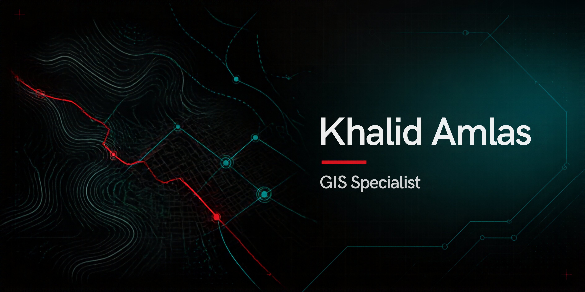

# Hi, I'm Khalid Mohd 👋
**Geospatial Analyst | AI-Driven Spatial Solutions & Market Intelligence**

I bridge the gap between **Geospatial Data Science**, **AI Optimization**, and **Visual Storytelling** to help organizations and businesses make data-backed location and market decisions.

---

---

---

### 🎯 What I Do (Services & Focus Areas)
Whether you are looking for a **full-time specialist** or a **project partner**, here is how I add value:

* **🗺️ Geospatial Project Management & Analysis:** End-to-end spatial data processing, site selection, and workflow optimization.
* **📈 AI-Powered Market & Location Intelligence:** Leveraging statistical modeling and machine learning to uncover market gaps, customer behavior, and spatial trends.
* **🗄️ Spatial Databases & Automation:** Structuring and querying spatial datasets using PostgreSQL/PostGIS and SQLite, automated via Python and R.
* **🎨 Data Visualization & 3D Mapping:** Transforming complex analytical outputs into clear, executive-ready visuals, dashboards, and 3D spatial renders.

---

### 🛠️ Tech Stack & Tools

**Data Science, GIS & AI**

**Databases, Web & Cloud**

**Design, 3D & Project Management**

---

### 🤝 Let's Connect & Collaborate
I am open to **Geospatial / Data Analyst roles** as well as **consulting and freelance projects** in spatial market analysis and visualization.

---

### 📊 GitHub Activity

  
  

